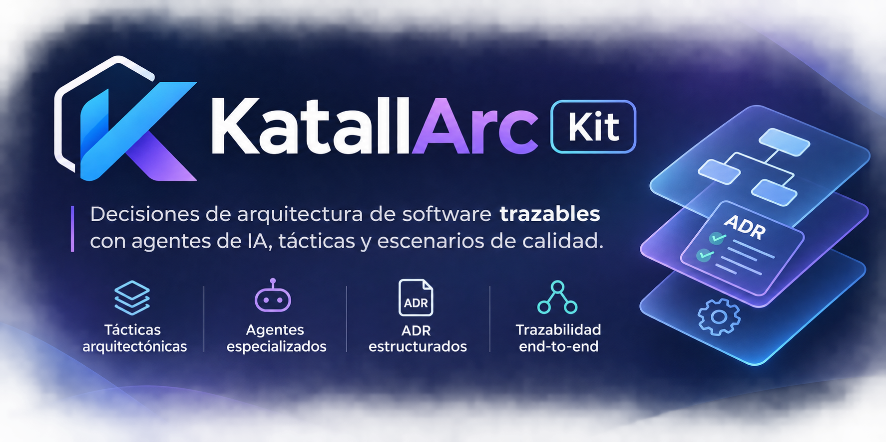

<p align="center">
  
</p>

# KatalIArc Kit

A cross-platform CLI for traceable software architecture decisions using quality scenarios, tactics, high-level patterns, structured arguments, and qualitative evaluation. Its methodology is shared across Codex, Claude Code, Gemini CLI, and GitHub Copilot. Toulmin can search a configured OpenAI vector store; after explicit user approval, KatalIArc can add accepted ADR projections to that store. Local ADR JSON and Markdown remain authoritative. It does not implement formal ATAM or automated compliance inference.

## Key features

- Capture stakeholder context, quality scenarios, and confirmed priorities in a utility tree.
- Propose architectural tactics and alternatives with traceable Toulmin arguments.
- Compare alternatives and review the evidence, risks, and trade-offs with Walton's critical questions.
- Track versioned architecture decision records (ADRs) through review and explicit approval.

## Installation

KatalIArc Kit 0.2.0 supports CPython 3.9 through 3.15. Use pip 21.3 or later for editable installation. On macOS, use a Python installation that provides pip, such as the installer from python.org.

The package installs `prompt-toolkit` for the interactive wizard and `jsonschema` to validate the versioned Walton rubric and evaluation records.

```sh
git clone https://github.com/MrNeo44/kataliarc-kit.git
cd kataliarc-kit
python3 --version
python3 -m pip install -e .
python3 -m pip show kataliarc-kit
```

The editable installation uses the checkout in place. Keep it at the same path, or use `python3 -m pip install .` for a regular installation. If pip reports a permissions error on a Python installation you manage, use `python3 -m pip install --user -e .`.

If Homebrew's Python reports `externally-managed-environment`, PEP 668 blocks the standard command. To keep using that interpreter without a virtual environment, explicitly allow the install for your user with `python3 -m pip install --user --break-system-packages -e .`. This setting applies to that invocation, and packages in your user site can take precedence over Homebrew packages. To use the standard command, choose a user-managed Python such as python.org's installer. [Homebrew's Python policy](https://docs.brew.sh/Language-Runtimes-and-Packages#python) · [pip install options](https://pip.pypa.io/en/stable/cli/pip_install/#options)

### Make the command available in Zsh

Run this block in the current terminal if `command -v kataliarc` returns nothing. To load it in new Zsh sessions, add the block once to `~/.zshrc`, after the configuration that selects your `python3`. It looks for the launcher in the user and default script directories of that interpreter and adds the directory only if it is missing from `PATH`.

```zsh
if kataliarc_scripts=$(python3 -c '
import os
import site
import sysconfig

for directory in (os.path.join(site.getuserbase(), "bin"), sysconfig.get_path("scripts")):
    launcher = os.path.join(directory, "kataliarc")
    if os.path.isfile(launcher) and os.access(launcher, os.X_OK):
        print(directory)
        break
' 2>/dev/null); then
    if [[ -n "$kataliarc_scripts" && ":$PATH:" != *":$kataliarc_scripts:"* ]]; then
        export PATH="$kataliarc_scripts:$PATH"
    fi
fi
unset kataliarc_scripts
```

```sh
command -v kataliarc
kataliarc --help
cd /path/to/your/project
kataliarc init
```

The command is available from any directory on that `PATH`. Initialization writes the project integration and architecture artifacts in the selected directory. After switching Python installations, reinstall KatalIArc with the new `python3` so its launcher points to that interpreter.

Python 3.9 is the minimum because the build uses setuptools 77 or later for SPDX license metadata and the update command uses dictionary union, which Python 3.9 introduced. pip resolves compatible releases of the build and runtime dependencies for the selected interpreter.

## Initialization

In an interactive terminal, `kataliarc init` guides you through provider selection, location, language, and confirmation. It plays a very soft retro 8-bit tune by default; pass `--no-music` to mute it. The screen clearing and music affect only the local terminal and machine.

```text
Select your AI coding provider:

  > OpenAI Codex (installed)
    Claude Code (not installed)
    Gemini CLI (installed)
    GitHub Copilot (not installed)

Use ↑ ↓ to navigate and Enter to select.
```

Detection reports CLI availability. Files can still be generated when the provider's CLI is unavailable. In a non-interactive terminal, select the provider with `--agent`.

```sh
kataliarc init --agent codex --directory . --language en
kataliarc init --agent claude --directory ../service --language en
kataliarc init --agent gemini --global --language en
kataliarc init --agent copilot --no-music
```

Generated artifacts and requested responses support English (`en`) and Spanish (`es`); Spanish is the default. JSON field names and contracts do not change between languages. Use `--no-banner` to suppress the banner.

## Integrations

### Codex agents

When you select Codex in `kataliarc init`, KatalIArc installs three native subagents. `AGENTS.md` tells the main Codex session when to delegate, what context to pass, and how to use the result.

| Subagent | Definition | Responsibility |
| --- | --- | --- |
| `pohl` | `.codex/agents/pohl.toml` | Elicits context and quality scenarios, records confirmed priorities, and organizes the utility tree. |
| `toulmin` | `.codex/agents/toulmin.toml` | Designs architectural alternatives and justifies their tactics and patterns. |
| `walton` | `.codex/agents/walton.toml` | Evaluates alternatives, reviews arguments, and recommends an outcome for human decision. |

Each subagent follows a methodology guide under `.agents/skills/`. The guides `kataliarc-pohl`, `kataliarc-toulmin`, and `kataliarc-walton` specify the steps and artifact contracts for their respective roles.

For a user-level Codex installation, `--global` places the instructions and agents under `~/.codex/` and the skills under `~/.agents/skills/`. In a project already initialized with KatalIArc, preview managed changes with `kataliarc update --dry-run` and apply them with `kataliarc update --yes`. [Codex custom agents](https://learn.chatgpt.com/docs/agent-configuration/subagents#custom-agents)

### Other providers

KatalIArc installs the shared methodology skills for Claude Code, Gemini CLI, and GitHub Copilot for VS Code. Claude Code uses `CLAUDE.md` for its instructions, Gemini CLI uses `GEMINI.md` and a TOML command, and GitHub Copilot uses `.github/copilot-instructions.md` and a custom agent definition. Methodological commands use the configured provider's local CLI with its own authentication.

### Documentation

- [Project instructions](AGENTS.md) and Codex role definitions for [Pohl](.codex/agents/pohl.toml), [Toulmin](.codex/agents/toulmin.toml), and [Walton](.codex/agents/walton.toml).
- Method guides for [elicitation](src/kataliarc/templates/skills/pohl/SKILL.md), [design and argumentation](src/kataliarc/templates/skills/toulmin/SKILL.md), and [evaluation and review](src/kataliarc/templates/skills/walton/SKILL.md).
- [Architecture decision process](src/kataliarc/resources/metamodel/process.md), [domain model](src/kataliarc/resources/metamodel/domain.json), [Walton rubric](src/kataliarc/resources/metamodel/walton-rubric.json), and [evaluation schema](schemas/evaluation.schema.json).

## Commands

```sh
kataliarc help
kataliarc help pohl
kataliarc pohl elicit
kataliarc pohl prioritize
kataliarc toulmin design
kataliarc walton evaluate
kataliarc walton evaluate --finalize
kataliarc walton review
kataliarc walton decide
kataliarc decide --help
kataliarc validate
kataliarc status
kataliarc rag-test --query "latency and cache invalidation"
kataliarc doctor
kataliarc doctor --json
kataliarc doctor --global
kataliarc update --dry-run
kataliarc update
kataliarc update --yes
kataliarc update --global --dry-run
```

### Command responsibilities

| Command | What it does | Role |
| --- | --- | --- |
| `help` | Lists general commands and methodological role/actions | None; local help |
| `init` | Sets up the project and installs the selected provider's integration | None; local setup |
| `pohl elicit` | Collects context and quality scenarios | Pohl |
| `pohl prioritize` | Organizes the utility tree and priorities | Pohl, with client confirmation |
| `toulmin design` | Proposes tactics and argued alternatives | Toulmin |
| `walton evaluate` | Assesses each complete alternative with C1–C6 and computes its action | Walton |
| `walton evaluate --finalize` | Validates recorded judgments and computes actions locally | Deterministic rules |
| `walton review` | Applies explicit Walton critical-question schemes to causal claims, evidence, assumptions, analogies, and consequences | Walton |
| `walton decide` | Integrates findings and recommends a supported, provisional, or indeterminate outcome | Walton |
| `validate` | Checks artifact structure and some references | None; automatic validation |
| `status` | Shows artifact status | None; local status check |
| `rag-test` | Makes one read-only search against the configured ADR vector store | None; diagnostic query only |
| `doctor` | Diagnoses the installation and its resources | None; automatic diagnostics |
| `update` | Updates KatalIArc-managed resources | None; automatic maintenance |

Role/action commands invoke the provider configured by `init`. With Codex, the prompt asks the main session to delegate the phase to its matching subagent and wait for the result. If delegation is unavailable, it asks the session to apply the skill directly.

```sh
kataliarc pohl elicit
kataliarc pohl prioritize
kataliarc toulmin design --repo ../service
kataliarc walton evaluate
kataliarc walton review
kataliarc walton decide
```

### ADR proposal and approval

After a successful `kataliarc walton review`, KatalIArc creates versioned `.kataliarc/decisions/ADR-NNN.json` and `.md` files in `PROPOSED` state from the review, context, tactics, and evaluation artifacts. Walton cannot approve a proposal. Inspect it with `kataliarc decide --show ADR-001`; view lifecycle, approval, version, and indexing history with `kataliarc decide --history ADR-001`.

Explicit approval is the only action that starts indexing:

```sh
kataliarc decide --accept ADR-001 --approver "Reviewer name"
kataliarc decide --reject ADR-001 --note "Reason"
kataliarc decide --request-changes ADR-001 --note "Clarify failover consequences"
kataliarc decide --retry-index ADR-001
kataliarc decide --accept ADR-002 --supersedes ADR-001
```

Indexing runs asynchronously in a detached local worker; approval returns while the ADR's indexing status is `PENDING` or `INDEXING`. Check progress with `kataliarc decide --show ADR-001` or `kataliarc status`. If indexing fails, the ADR remains `ACCEPTED` and its independent indexing status becomes `FAILED`; retry with `--retry-index`. KatalIArc stores the complete ADR locally and indexes a retrieval projection with origin, version, approval, scenario, tactic, and rubric metadata. Rejected and proposed ADRs are never indexed. Superseded ADRs remain in local history and are marked so Toulmin does not treat them as current. Acceptance records the user's choice; it does not prove empirical compliance. The ADR records the rubric judgments, deterministic actions, and ATAM-inspired findings.

### Using Pohl

1. Put stakeholder notes and context in `.kataliarc/context.md`.
2. Run `kataliarc pohl elicit`. Review the structured information and scenarios in `.kataliarc/context.json`; unresolved information stays marked as unknown rather than being invented.
3. Confirm scenario priorities with the client representative, then run `kataliarc pohl prioritize`. Confirmed priorities are stored in `context.json`; `utility-tree.json` only groups scenario IDs by quality attribute.
4. Run `kataliarc validate` to check the scenario references, then continue with `kataliarc toulmin design`.

`context.json` is the source of truth for scenario descriptions and priorities. `utility-tree.json` contains references only; it does not duplicate scenario descriptions or priorities.

Only the role/action pairs shown in the command table are valid. The Toulmin `design` action prepares repository evidence and performs RAG retrieval for architecture work. `rag-test` runs a separate one-query connection diagnostic.

### How the roles use the process and metamodel

| Role | Process responsibility | Main metamodel concepts | Handoff |
| --- | --- | --- | --- |
| Pohl | Elicit stakeholder context, business problem/goals/requirements, constraints, drivers, and quality scenarios; expose gaps and confirm priorities | `Stakeholder`, `BusinessProblem`, `BusinessGoal`, `BusinessRequirement`, `ArchitecturalProblem`, `ArchitecturalConstraint`, `ArchitecturalDriver`, `QualityScenario`, `UtilityTreeBranch` | Toulmin receives traceable scenarios and constraints; priorities remain in `context.json` |
| Toulmin | Generate tactics, arguments, interactions, and assembled alternatives | `ArchitecturalTactic`, `ArchitecturalPattern`, `ArchitecturalArgument`, `ArchitecturalAlternative` | Walton evaluates the alternatives |
| Walton | Assess every alternative/scenario pair using the versioned qualitative rubric; identify ATAM risks, sensitivity points, and cross-scenario trade-offs; apply Walton critical questions; recommend an outcome | `ScenarioAssessment`, `SensitivityPoint`, `CriticalQuestionAssessment`, `EvaluationIteration`, `ArchitecturalRisk`, `TradeOff` | User or authorized decision maker accepts, rejects, or requests changes |

Each skill file states its scope, inputs, outputs, and handoff. KatalIArc installs the machine-readable domain vocabulary in `.kataliarc/metamodel/domain.json`, its entity diagram in `domain.mmd`, the process guidance in `process.md`, and its activity diagram in `process.mmd`. `domain.json` is the single metamodel source; `walton-rubric.json` is the versioned qualitative classification contract. Schemas validate artifact structure. Each skill is instructed to read the shared process and use only its relevant concepts.

An `ArchitecturalTactic` is a design decision that influences a quality attribute. Its `mechanism` explains how the decision is realized. Applying an `ArchitecturalPattern` is a design decision about the organization of components and connectors. An `ArchitecturalAlternative` uses one or more tactics and may assemble zero or more patterns, so alternatives can share a pattern and vary how a tactic is realized. An `ArchitecturalDecision` records the selection or disposition of an alternative.

### Unified Walton rubric

For each complete alternative, Walton assesses pertinence (C1), mechanism and evidence (C2), applicability (C3), sufficiency (C4), architectural consequences (C5), and argument strength (C6). Records in `.kataliarc/evaluation.json` retain each scenario judgment and its justification, evidence, assumptions, critical questions, and findings. An alternative ID identifies the assembled combination, and its tactic IDs link to the design produced by Toulmin.

| First condition met | Action |
| --- | --- |
| R1 · Any `NO_CUMPLE` with a confirmed blocker linked to the assessed scenario or a mandatory constraint | `DESCARTAR` |
| R2 · Any `INCIERTO` with missing critical information or an unresolved objection that prevents judgment | `POSPONER` |
| R3 · Any `REQUIERE_AJUSTE` with a concrete correction | `MODIFICAR` |
| R4 · All six criteria `CUMPLE` | `MANTENER` |

The engine consolidates scenario judgments for each criterion using the same priority order. To validate `NO_CUMPLE`, record the decisive blocker, direct evidence, and an `impediment_ref` to the assessed scenario or an identified constraint marked `mandatory: true` in `context.json`. ATAM risks remain findings. A risk with an identified mitigation that is still needed can support `REQUIERE_AJUSTE`. Experimental compliance requires its own evidence. Existing `NO_CUMPLE` judgments need the new reference before they can be validated again.

Run `kataliarc walton evaluate` to invoke Walton and compute the results. For existing valid judgments, `kataliarc walton evaluate --finalize` computes results without a model call. `kataliarc walton review` revalidates and recalculates before persisting a proposed ADR. `kataliarc walton decide` uses the saved actions to describe trade-offs and remaining decisions for the authorized decision maker.

Each criterion records `value`, `justification`, `evidence_refs`, and `assumptions`. Use `adjustment` for a concrete fix and `pending_information` for missing evidence or an unresolved objection that blocks judgment. An impediment reference takes the form `{"scenario_id": "QS-01"}` or `{"constraint_id": "CON-01"}`. The CLI records the calculated action and rule under `alternative_results` and summarizes them in `evaluation.md`.

The evaluation command applies bounded Toulmin refinements only for `MODIFICAR`. Configure `{"walton": {"max_iterations": 2}}` in `.kataliarc/config.json` (default 3, maximum 5). Recurring requests stay explicitly unresolved when the cap is reached.

#### Upgrade an existing project

1. Reinstall KatalIArc using its existing installation method so pip resolves the validation dependency.
2. Run `kataliarc update --dry-run` from the initialized project, inspect the proposed changes, and apply them with `kataliarc update --yes`. Add `--global` for a user-level installation.
3. Reevaluate records from the previous rubric with `kataliarc walton evaluate`. Previous judgments enter the assessment history when replaced. For records already using the unified rubric, complete any missing `impediment_ref` values before running `kataliarc walton evaluate --finalize`. Historical ADRs retain their versions and source records.

The [complete combination example](examples/walton-combination.json) uses fictional evidence to show how horizontal scaling and caching interact. It records two scenario assessments, a risk, a justified no risk, a sensitivity point, a trade-off, and Walton's objections. To reproduce it in an initialized project, copy its `context`, `utility_tree`, `tactics`, and `evaluation` objects to the corresponding files under `.kataliarc/`, then run `kataliarc walton evaluate --finalize`. The cold rollout requires an adjustment (C4), so the output is `ALT-003 MODIFICAR (R3)`.

### Toulmin design and historical ADR search

Run design from the KatalIArc project directory. `--repo` selects a separate repository for bounded, read-only inspection; it is never modified. Before invoking the provider, KatalIArc writes `.kataliarc/repository-analysis.json` and `.kataliarc/toulmin-input.json`. These are reviewable inputs containing file/line references, candidate tactics, and any historical ADR excerpts returned by search.

The [ISO/IEC 25010:2023 product quality vocabulary](src/kataliarc/resources/metamodel/iso-25010-2023.json) covers all nine characteristics and 40 subcharacteristics. `init` and `update` place it in `.kataliarc/metamodel/`. The [tactic catalog](src/kataliarc/resources/tactics/catalog.json) covers the ten quality-attribute taxonomies in chapters 4–13 of [Software Architecture in Practice, fourth edition](https://www.informit.com/store/software-architecture-in-practice-9780136886099). Entries include their mechanism, conditions, limitations, and chapter and figure references. The English identifiers and Spanish aliases support lookup while preserving the original scenario labels.

Catalog associations are KatalIArc mappings based on the intended effects of each tactic. A characteristic query includes candidates associated with its subcharacteristics. A subcharacteristic query uses its explicit associations. Project-specific quality attributes remain usable, and an attribute with no associated tactics yields an empty candidate list. RAG queries by scenario come before tactic-specific queries so scenarios without catalog candidates can still use the available search budget.

Configure an existing OpenAI vector store with `kataliarc init --agent codex --rag-vector-store-id vs_...`, by setting `OPENAI_VECTOR_STORE_ID` in the process environment or the KatalIArc project's `.env`, or by adding `{"rag": {"vector_store_id": "vs_..."}}` to `.kataliarc/config.json`. Set `OPENAI_API_KEY` in the environment or project `.env` as well. Keep credentials out of source control. KatalIArc sends bounded text queries to the OpenAI vector-store search endpoint during `kataliarc toulmin design`; use `--no-rag` to skip those requests. Search failures leave the workflow usable and are reported as warnings. When no vector store is configured, Toulmin proceeds with repository and scenario evidence only.

To check connectivity without invoking a provider or running the full design phase, use `kataliarc rag-test --query "your architecture question"`. It makes exactly one search request and prints the matching ADR identifiers or filenames and scores, without dumping the retrieved text. Use `--max-results 1` for a very small response (allowed range: 1–5).

```sh
kataliarc toulmin design --repo ../service
kataliarc toulmin design --repo ../service --no-rag
```

Toulmin compares catalog candidates and documented project experience against the same quality scenario and constraints. An ADR can help justify a catalog tactic, reveal its limits, or suggest a candidate tactic or pattern. The mechanism links the historical observation to the proposed design decision and explains its expected effect. Toulmin records support, conditions, and counterevidence in `backing`, `qualifier`, and `rebuttal`.

The prepared input preserves source IDs and marks transfer to the current design as an inference/hypothesis. Retrieved content is treated as untrusted data. Toulmin records all six argument elements and passes unresolved claims to Walton for critical review.

Toulmin may derive a tactic from historical experience or from the current scenario. For a tactic outside the supplied catalog candidates, it records the design decision, quality attribute, mechanism, conditions, limitations, and sources, then presents the argument for user validation. After explicit validation for catalog inclusion, add a distinct entry to [the kit catalog](src/kataliarc/resources/tactics/catalog.json) with its provenance. Keep the evidence status of the argument and the conditions under which the tactic applies.

`doctor` checks the provider, resources, JSON files, schemas, metamodel, and permissions without writing files. It also reports knowledge paths present in older configurations. `--json` produces output without a banner or ANSI formatting. `update` uses the installed package templates to refresh managed resources and can add missing provider integration files. It compares existing files against the hashes in `.kataliarc/managed-files.json`, preserves conflicts, and backs up intact files that it replaces. Use `--dry-run` to preview changes and `--yes` to apply them non-interactively.

Architecture workflow artifacts are written to `.kataliarc/` for review. The client representative must confirm priorities. Hypotheses carry their own provenance labels. Verified compliance requires independent evidence.

`context.json` is the source of truth for quality scenario descriptions and priorities. `utility-tree.json` only groups scenario IDs under quality-attribute branches; it does not repeat descriptions or priority values. `kataliarc validate` checks that each tree reference exists and is grouped under the scenario's attribute.

## Troubleshooting

- **`--agent` is required in a non-interactive terminal:** use `kataliarc init --agent codex` (or `claude`, `gemini`, or `copilot`).
- **The provider is not on `PATH`:** skills can still be installed; install and authenticate the provider CLI separately before running a methodological role/action command.
- **Update conflicts:** run `doctor` to inspect the state, review files marked `CONFLICT`, and run `update` again when you want to adopt available changes.

## Development and tests

```sh
python3 -m pip install -e '.[test]'
python3 -m pytest
```
